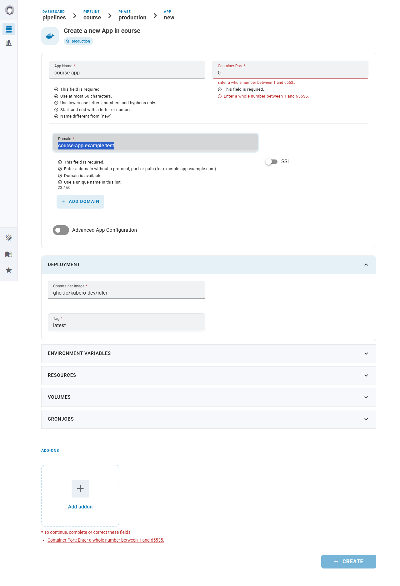
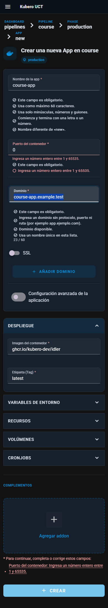
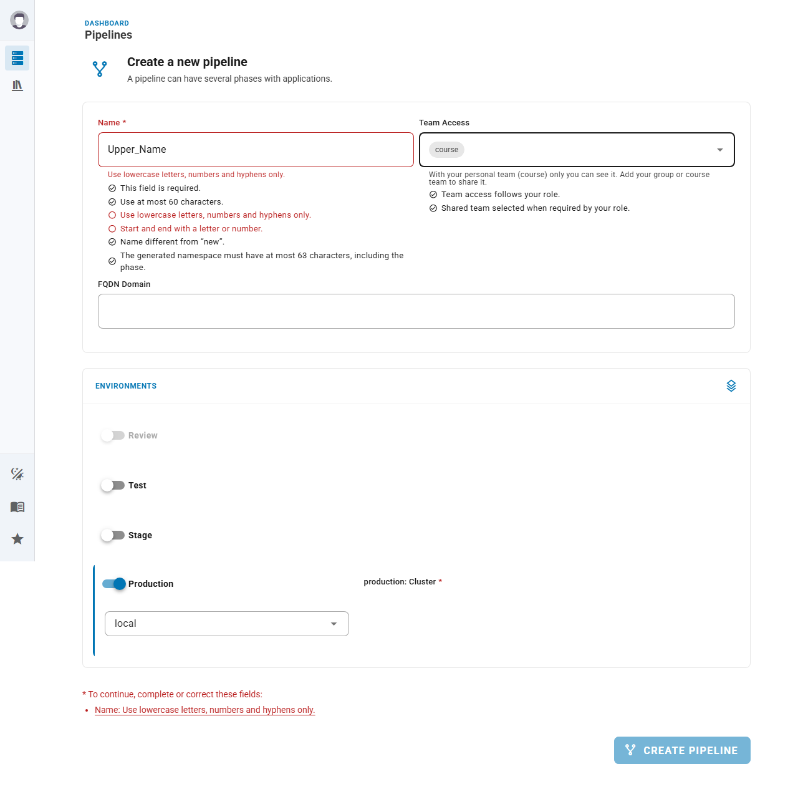
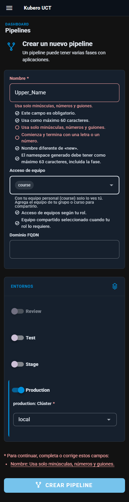

# Validación de formularios — issue #138

Los formularios comparten reglas tipadas, requisitos que se actualizan al escribir, errores tras perder el foco y un resumen con asterisco rojo que permite navegar al campo pendiente. Los manejadores comprueban la validez antes de enviar y bloquean solicitudes duplicadas mientras guardan. Las reglas dependen del modelo completo, también cuando un panel está cerrado.

Se conserva la política de contraseñas de ocho caracteres. No se modificaron dependencias, contratos API, Prisma, CLI, operador ni CRDs. Los nombres personales admiten tildes y espacios; los identificadores inmutables existentes no requieren renombrado.

## Commits por área

Todos los commits referencian el issue real #138 y se mantienen separados en la rama de trabajo.

| Área | Commit | Comprobaciones específicas |
| --- | --- | --- |
| Base compartida | [8b9e83f9](https://github.com/open-source-uct/kubero/commit/8b9e83f9) | Reglas, validez independiente de interacción, actualización inmutable y compilación de mensajes ES/EN. |
| Apps | [533acf1e](https://github.com/open-source-uct/kubero/commit/533acf1e) | Puertos, imágenes, dominios y variables; Enter inválido no envía y el válido genera una solicitud. |
| Configuración avanzada de apps | [8cf383dd](https://github.com/open-source-uct/kubero/commit/8cf383dd) | UID/GID, autenticación, réplicas, volúmenes, cron, anotaciones y red; ocultar opciones no omite errores activos. |
| Pipelines | [cf558c16](https://github.com/open-source-uct/kubero/commit/cf558c16) | Nombres, namespaces, clústeres, equipos según rol y variables; foco desde el resumen. |
| Complementos y builds | [685c8057](https://github.com/open-source-uct/kubero/commit/685c8057) | Campos dinámicos, nombre con prefijo, requisitos de Postgres, cantidades y referencias de build; formularios independientes. |
| Cuentas y perfil | [7230781e](https://github.com/open-source-uct/kubero/commit/7230781e) | Usuarios, equipos, roles fijos, perfil, confirmación de contraseña y reapertura de diálogos. |
| Acceso, tokens y avatar | [2d0fd7a5](https://github.com/open-source-uct/kubero/commit/2d0fd7a5) | Login y recuperación, fechas completas, años bisiestos, tipo de imagen y límite de 100 KiB. |
| Runpacks y tamaños de pod | [8490eb87](https://github.com/open-source-uct/kubero/commit/8490eb87) | Tres etapas de runpack, descripción, cantidades y reserva ≤ límite. |
| Configuración, setup y plantillas | [9c42ebe7](https://github.com/open-source-uct/kubero/commit/9c42ebe7) | URLs, integraciones, secretos preservados, YAML/contextos, catálogos, destinos de plantillas, notificaciones y fechas de Actividad. |

El último commit agrega la suite transversal Playwright, su comando, esta documentación y las capturas. Su hash se obtiene con `git log -1` en la entrega.

## Verificación

| Comando / comprobación | Resultado |
| --- | --- |
| `pnpm --dir client run test:unit` | 58 pruebas aprobadas. |
| `pnpm --dir client run test:validation` | 23 pruebas Playwright aprobadas en Chromium. |
| axe en apps y pipelines | Sin infracciones en los formularios examinados, en escritorio claro/inglés y móvil oscuro/español. |
| `pnpm --dir client run build` | Aprobado, incluye `vue-tsc --noEmit`; conserva advertencias de chunks mayores de 500 kB. |
| `pnpm --dir client exec eslint . --ignore-path .gitignore` | Sin errores; 22 advertencias previas por variables/importaciones sin uso. |
| `git diff --check` | Sin errores de espacios. |
| Detector Impeccable | Ejecutado sobre las vistas afectadas; dos avisos de estilos preexistentes en perfil y plantillas, fuera del cambio de validación. |

La suite de validación usa un servidor Vite en `127.0.0.1:5174`, sesiones y datos sintéticos, e intercepta todas las solicitudes API. No necesita credenciales ni modifica clústeres o bases de datos. La configuración está separada del Playwright existente para evitar ejecutar accidentalmente pruebas contra un backend real.

Tras aclarar los textos de los requisitos cumplidos se repitieron las 58 pruebas unitarias, las dos pruebas visuales de accesibilidad y el build; todas aprobaron.

## Mantenimiento y compatibilidad

- Definir las reglas en `client/src/validation/` usando los predicados compartidos de `validationRules.ts`. El mismo resultado alimenta la validez, el error y los requisitos visibles.
- Usar `createFormValidation` o `formValidationMixin`, `ValidationField` y `FormValidationSummary`. Asociar cada campo con un ID estable; agregar `reveal` cuando esté dentro de una pestaña o panel.
- Usar `active` únicamente cuando una función esté desactivada. La visibilidad de un panel no determina la validez de sus datos.
- Los cambios anidados de configuración se emiten de forma inmutable. Las credenciales existentes se conservan si no se reingresan: el backend reemplaza el objeto de secretos completo.
- Los parámetros de errores y resúmenes no deben contener contraseñas, tokens ni valores secretos. Los ejemplos de correo y cron deben escapar el carácter `@` en la sintaxis de `vue-i18n`.
- La validación del servidor continúa siendo la autoridad ante conflictos, permisos o cambios concurrentes. La reversión se realiza mediante PR revirtiendo los commits del issue; no requiere migraciones.

## Evidencia visual

Capturas generadas con datos sintéticos por las pruebas de accesibilidad.

| Escritorio claro | Móvil oscuro |
| --- | --- |
|  |  |
|  |  |
